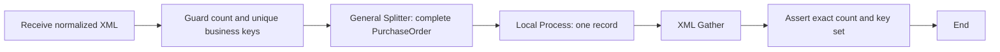

# Lập kế hoạch và kiểm tra cách dùng component CPI

Bản này bổ sung lớp quyết định có quy tắc cho **18 node types hiện được compiler hỗ trợ**. Nó giúp MCP chọn và cấu hình đúng hơn trong những tình huống được mô hình hóa; không tự nhận hỗ trợ mọi component trong SAP palette hoặc biết nghiệp vụ backend khi chưa có contract.

## Ba tool mới

| Tool | Dùng khi nào | Kết quả |
| --- | --- | --- |
| `get-iflow-component-catalog` | Trước khi thiết kế một use case chưa quen | Khi nên dùng từng component, đầu vào bắt buộc, lỗi cần tránh và danh sách chưa hỗ trợ. |
| `plan-iflow` | Có mục tiêu và contract đầu vào/đầu ra | Blueprint cụ thể hoặc `needs-input` với các thông tin còn thiếu; không tự đoán endpoint, XPath hay schema SAP. |
| `analyze-iflow-blueprint` | Trước preview/create, có thể kèm sample XML | Errors, warnings, số record/group được XPath chọn trên sample và các giới hạn kiểm chứng. |

Preview và create cũng trả `analysis`. Compiler chặn semantic errors đã biết; warnings yêu cầu đánh giá theo nghiệp vụ, không được coi là chứng nhận production. Server có 38 tools; client đang chạy bản cũ cần khởi động lại MCP server sau khi pull/build.

## Chọn theo mục tiêu

| `goal` | Cách lập flow |
| --- | --- |
| `transform` | Tự chọn XML→JSON hoặc JSON→XML khi input/output rõ; mapping khác phải cung cấp step và resource. |
| `validate` | XML Validator với XSD được cung cấp. Business/master-data rules vẫn phải khai báo riêng. |
| `route` | Router với các nhánh có điều kiện và đúng một default. |
| `split-api` | Input guard → General Splitter → Local Process worker → XML Gather → completeness audit. |
| `parallel-enrichment` | Multicast → các nhánh độc lập → Join → Gather. |
| `ordered-fanout` | Sequential Multicast theo thứ tự nhánh → Join → Gather. |
| `deliver` | HTTP/OData dùng Request Reply; JMS/SFTP dùng Send. |
| `reuse` | Chuyển các bước được cung cấp vào Local Integration Process rồi gọi bằng Process Call. |

Mỗi nhánh/step phải có ID duy nhất. Source HTTPS cần endpoint; Timer/SFTP dùng cấu hình sender phù hợp. Các resource Groovy, mmap, XSLT, XSD, EDMX phải được bundle. Planner là lớp tạo graph từ yêu cầu có cấu trúc, không phải bộ hiểu mọi mô tả tự nhiên mà không cần làm rõ.

## Split và gọi API theo từng PO

Ví dụ input có hai `PurchaseOrder`, lần lượt 2 item và 1 item. Một API tạo PO phải nhận **hai request**, không phải ba request theo item. Plan mẫu nằm ở [SmartPurchaseOrderApi.json](resources/plans/SmartPurchaseOrderApi.json).



Worker dùng Content Modifier để đặt correlation/key headers, XSLT Mapping để bỏ envelope mà General Splitter giữ lại, Request Reply để gọi API, rồi kiểm tra HTTP **và** business response trước khi tạo XML result envelope. Có Exception Subprocess/Error End trong chính worker và trong main process. Các script guard/audit có giới hạn payload; không attach request/response business payload vào MPL.

- Bắt buộc khai báo `businessUnit`, `recordElement`, XPath chọn record, `keyXPath` tương đối và payload mẫu. Sample chỉ để phân tích; không được nhúng vào scripts production.
- Planner hỗ trợ XPath child-element cụ thể cho split-api, có prefix/namespace. Không tự suy rằng XPath chọn đúng PO chỉ vì nó hợp lệ về cú pháp.
- `grouping=1` trong mẫu API để một operation ứng với một business record. Bounded input: 1 MiB và `maxRecords` tối đa 1.000; đây là giới hạn của pattern, không phải giới hạn chung của CPI.
- Key phải duy nhất trong batch, không rỗng, không chứa giá trị dùng để traversal hoặc header injection. Runtime kiểm tra lại, không chỉ tin sample.
- Mặc định tuần tự. Parallel yêu cầu concurrency từ 2–50; write song song yêu cầu khai báo receiver thực sự enforce idempotency. Timeout budget phải lớn hơn thời gian chờ ước lượng từ maxRecords/concurrency và receiver timeout.
- Sau Gather phải đủ số lượng **và đúng tập key**. Thiếu, trùng hoặc key ngoài batch đều làm flow fail, thay vì trả thành công với kết quả thiếu.
- Fail-fast không rollback các API call đã commit trước đó. Batch lỗi một phần cần reconcile theo business key; không replay nguyên batch để xử lý timeout chưa rõ kết quả.

## HTTP receiver có cấu hình rõ

`receiver` HTTP hỗ trợ GET, HEAD, POST, PUT, PATCH, DELETE; auth `none`, `basic`, `oauth2ClientCredentials` qua credential alias; timeout bằng **milliseconds**; request/response header allowlists; response format; và `errorHandling` throw/route.

`sendBody` cho phép chọn rõ trường hợp GET/HEAD/DELETE cần body. `appendRecordKeyToPath` thêm `${header.X-Smart-Key}` vào phần path của một HTTPS URL cố định, phục vụ API kiểu `/orders/{key}`; pattern split-api cung cấp kiểm tra key tương ứng. Không cho wildcard/Authorization/Camel routing headers trong allowlist này.

Auth alias phải tồn tại và có quyền ở môi trường đích. `responseFormat` trên receiver chỉ là thông tin phân tích; **không tự thêm guard** vào một graph tùy ý. Mẫu split-api mới sinh guard thực thi: JSON kiểm tra required fields và expected values; XML kiểm tra required XPath/value; text phải có `bodyContains` được chỉ định. Các contract do người thiết kế cung cấp vẫn cần đối chiếu tài liệu API.

`errorHandling=route` phải có Router ngay sau Request Reply; analyzer vẫn cảnh báo phải rà các điều kiện HTTP status. Mẫu split-api hiện dùng fail-fast (`throw`), không sinh partial-success/retry orchestration tự động. Retry trên HTTP adapter được tắt và error attachments bị tắt trong template xuất ra.

Header `Idempotency-Key` chỉ được sinh khi `receiverEnforcesIdempotency=true`; header này **không tự tạo cơ chế chống trùng ở backend**. Không có bảo đảm exactly-once hoặc tự retry khi timeout.

## Kiểm tra ngữ nghĩa bổ sung

- Phát hiện JSON đưa trực tiếp vào XML step trên các path xác định được format.
- Kiểm tra XPath/namespace và record count bằng sample; báo sai element hoặc không chọn được record.
- Phát hiện Gather không ghép đúng Splitter/Join trên từng path, split chưa đóng trong local process, hoặc stack split khác nhau giữa các branch khi Join.
- Chặn Stop on Exception kết hợp handler Message End có thể nuốt lỗi; kiểm tra cả worker được gọi.
- Cảnh báo text concatenation không tạo XML/JSON hợp lệ, parallel timeout có thể thiếu kết quả, API write có thể commit một phần, OData pagination/CSRF và Send chưa chứng minh nghiệp vụ downstream hoàn tất.

`context.sampleXml` phải đại diện payload tại điểm split; analyzer không thực thi các transform trước đó để tạo sample mới. JSON fan-out chưa có envelope/mapping rõ được trả về needs-input, không tự nối chuỗi thành JSON. Router hỗ trợ expressionType XML hoặc NonXML theo điều kiện được cung cấp.

Format suy luận sau script tùy ý hoặc lời gọi local process có thể là unknown. Analyzer không đọc hiểu toàn bộ Groovy/mmap, chứng minh logic Router, hay chứng nhận tính đầy đủ của nghiệp vụ; các cảnh báo phản ánh giới hạn này.

## Chạy kiểm thử

```sh
npm ci --ignore-scripts
npm run build
npm test -- --runInBand --coverage=false
npm run test:po-dryrun
npm run test:patterns
# Chỉ khi đã cấu hình tenant thử nghiệm trong .env:
npm run test:patterns:live
```

`test:po-dryrun` chuẩn bị Groovy 2.4.21 với SHA-256 đã pin. Bộ `test:patterns` thực thi chính Groovy/XSLT được planner sinh và gửi HTTP thật tới mock loopback; harness mô hình hóa một tập con Splitter/Gather, không phải CPI emulator. Nó kiểm tra complete-record request, số call, correlation, 401/429/500, timeout không replay, business rejection, sai format, key trùng và kết quả Gather thiếu/sai.

Live runner tạo package/artifacts thử nghiệm có tên riêng. Ba runtime cases thay transport HTTP bằng Content Modifier trả response giả; **Splitter, Local Process, header XPath, XSLT, guards, Gather và exception handling vẫn chạy thật trên CPI**. HTTP None/Basic/OAuth và PATCH được tạo để SAP validation, không deploy các receiver gọi ra ngoài. Vì vậy kết quả này không chứng minh HTTP adapter/auth/backend I/O production.

Nếu bị ngắt sau khi cả ba runtime task đã submit, `npm run test:patterns:live -- --resume` dùng lại IDs/task đã lưu, kiểm tra tiếp và bổ sung HTTP design validation còn thiếu; không deploy lại các runtime cases. Reports trong `work/` là private; chỉ publish bản đã rà dữ liệu tenant/credentials.

## Tài liệu SAP dùng để đối chiếu

- [Splitter exception handling và local worker](https://help.sap.com/docs/integration-suite/sap-integration-suite/handle-exceptions-when-using-splitter-pattern)
- [Gather và Join](https://help.sap.com/docs/integration-suite/sap-integration-suite/define-gather-and-join)
- [HTTP receiver: method, authentication, timeout, retry và idempotency](https://help.sap.com/docs/integration-suite/isuite-integrations-and-apis/http-receiver-adapter)

Các component chưa nằm trong schema như IDoc receiver, Data Store, Mail, ProcessDirect, Iterating Splitter, JMS sender hoặc OData V4 được báo rõ là unsupported; tool không giả vờ đã cấu hình hay kiểm thử chúng.

## Kết quả kiểm chứng 2026-10-22

- TypeScript compile pass; 115/115 unit tests trong 13 suites.
- 21/21 mock HTTP/Groovy/XSLT cases pass; request body chứa đúng từng PO và số call được đếm độc lập.
- Hồi quy Excel: 28/28 workbook cases và 6/6 component/guard probes pass.
- CPI sequential và parallel: SAP validation passed, deployment SUCCESS, runtime STARTED, MPL COMPLETED, đủ 2 record/key.
- CPI bad-response: runtime STARTED, MPL FAILED, SmartErrorCode=SMART_BUSINESS_RESPONSE, local worker handler ghi metadata đúng.
- HTTP None, Basic và OAuth2 Client Credentials/PATCH: SAP validation passed; chưa deploy/gọi backend.

[Native CPI report](docs/component-intelligence-live-2026-10-22.json) · [Mock report](docs/component-intelligence-mock-2026-10-22.json). Chưa kiểm tra editor UI hoặc chứng từ nghiệp vụ backend.
