# Excel Purchase Orders to IDoc: dry-run scenario

Bộ test cho yêu cầu Excel `.xlsx` → kiểm tra dữ liệu → XML → IDoc ứng viên. Người dùng chọn dry-run vì chưa có SAP backend. Flow không có receiver channel, không đọc SFTP, không gửi email và không tạo PO thật.

## Quyết định nghiệp vụ và phạm vi

SAP mô tả `PORDCR1` là giao diện IDoc cho `BAPI_PO_CREATE1`: [SAP Purchase Order creation](https://help.sap.com/docs/SUPPORT_CONTENT/spmm/3362167600.html). Ví dụ dùng message type `PORDCR1`, basic type ứng viên `PORDCR103`, với các segment header/item được SAP liệt kê tại [PORDCR103 technical information](https://help.sap.com/docs/PRODUCT_ID/9905622a5c1f49ba84e9076fc83a9c2c/781c63547de8e630e10000000a44538d.html).

Chưa có XSD export từ backend nên payload **chưa được chứng nhận hợp lệ với schema SAP đích**. Wrapper `DryRunIdocBatch` và các `Order` chỉ phục vụ kiểm thử; không phải payload để gửi trực tiếp vào IDoc receiver. Không tự chọn ORDERS05 cho nghiệp vụ tạo Purchase Order.

Các chỗ “Hình ảnh” trong đề không có ảnh/dữ liệu đính kèm. Vì vậy file mẫu, trường Excel, mã tổ chức và master data bên dưới là giả lập được khai báo rõ, không phải dữ liệu lấy từ hệ thống của người dùng.

## iFlow: 10 thành phần chính

```mermaid
flowchart LR
  A[Timer run once] --> B[Content Modifier: synthetic XLSX and test context]
  B --> C[Groovy: bounded OOXML reader]
  C --> D[Groovy: business rules and fixture master data]
  D --> E[XML Validator: canonical PO contract]
  E --> F[XSLT Mapping: candidate IDocs]
  F --> G[XML Validator: local candidate contract]
  G --> H[Content Modifier: NOT_POSTED]
  H --> I[Groovy: semantic audit and MPL metadata]
  I --> J[End]
```



Có thêm Exception Subprocess để ghi mã lỗi và giữ trạng thái FAILED. Tổng structural component count là 14, trong đó 10 node thuộc main process. Luồng chính giảm từ 8 xuống 3 Groovy steps: đọc Excel, kiểm tra nghiệp vụ/master fixture, và audit/logging. Có 2 Content Modifier, 2 XML Validator và 1 XSLT Mapping; ngoài ra có 1 script trong Exception Subprocess. Bộ test thực thi đúng Groovy/XSLT/XSD được bundle, không thay parser bằng bản JS.

Không giả định Apache POI tồn tại trên CPI. Reader dùng `ZipInputStream`, `XmlSlurper` và Java/Groovy chuẩn. Đây là OOXML reader giới hạn theo input contract, không thay thế một thư viện Excel tổng quát.

## Excel contract

File [purchase-orders.xlsx](fixtures/purchase-orders.xlsx) có đúng một sheet `PurchaseOrders`, header tại hàng 1, các cột theo thứ tự:

| Cột | Trường | Kiểu và ý nghĩa |
| --- | --- | --- |
| A | OrderRef | Text, nhóm các dòng vào một PO; không được tự nhận là số PO đã tạo trong ERP. |
| B | CompanyCode | Text 4 chữ số. |
| C | DocType | Mã loại PO, ví dụ NB. |
| D | Vendor | Text 10 chữ số; giữ leading zeros, không nhận numeric cell. |
| E | PurchOrg | Text 4 ký tự. |
| F | PurchGroup | Text 3 ký tự. |
| G | Currency | Text 3 chữ in hoa. |
| H | ItemNo | 1–5 chữ số, chuẩn hóa thành 5 chữ số. |
| I | Material | Text tối đa 18 ký tự cho mẫu này. |
| J | Plant | Text 4 ký tự. |
| K | Quantity | Numeric > 0, tối đa 3 chữ số thập phân. |
| L | Unit | Mã đơn vị, ví dụ EA/KG. |
| M | NetPrice | Numeric > 0, tối đa 4 chữ số thập phân. |
| N | PriceUnit | Số nguyên dương. |
| O | DeliveryDate | Excel date, serial date theo hệ 1900/1904 hoặc text ISO yyyy-mm-dd. |

Mẫu có **2 PO / 3 item**; giá trị số là numeric cells, vendor/material là text, ngày giao là typed Excel date. Bộ test bổ sung shared strings, inline strings và hệ ngày 1904. Reader xử lý UTF-8 BOM trong các XML part.

Quy tắc bổ sung: mandatory fields; header của cùng OrderRef phải nhất quán; không trùng cặp OrderRef/ItemNo; ngày phải hợp lệ; vendor phải thuộc company/purchasing organization; material phải tồn tại tại plant và có unit phù hợp. Các kiểm tra master data chỉ dùng [fixture JSON](fixtures/master-data.json), được đánh dấu `SYNTHETIC_FIXTURE`.

Từ chối formula cells (không dùng cached formula result), workbook nhiều sheet, merged cells, macros, DTD/entities, đường dẫn ZIP không an toàn, shared-string index sai và dữ liệu vượt giới hạn. Giới hạn: 2 MiB file nén, 4 MiB/part, 8 MiB tổng giải nén, 200 ZIP entries, 1.000 dòng dữ liệu và 256 ký tự/cell. Không hỗ trợ `.xls`, password-protected workbook hoặc mọi biến thể OOXML.

## Mapping được kiểm tra

| Canonical field | Candidate segment/field |
| --- | --- |
| CompanyCode, DocType | E1BPMEPOHEADER / COMP_CODE, DOC_TYPE |
| Vendor, PurchOrg, PurchGroup, Currency | E1BPMEPOHEADER / VENDOR, PURCH_ORG, PUR_GROUP, CURRENCY |
| ItemNo, Material, Plant | E1BPMEPOITEM / PO_ITEM, MATERIAL, PLANT |
| Quantity, Unit | E1BPMEPOITEM / QUANTITY, PO_UNIT |
| NetPrice, PriceUnit | E1BPMEPOITEM / NET_PRICE, PRICE_UNIT |
| DeliveryDate, Quantity | E1BPMEPOSCHEDULE / DELIVERY_DATE, QUANTITY |
| Change indicators | E1BPMEPOHEADERX, E1BPMEPOITEMX, E1BPMEPOSCHEDULX |

Control record có DIRECT=2, MESTYP=PORDCR1, IDOCTYP=PORDCR103 và logical systems giả lập. Candidate thêm TESTRUN=X nhưng **biện pháp ngăn posting của bài test là không có receiver channel**, không dựa vào việc backend có chấp nhận TESTRUN hay không. Contract checker kiểm tra counts, field values và change indicators; đây không phải XSD validation từ backend. Mapping dùng native XSLT Mapping với [stylesheet](mapping/MapCandidateIdocs.xsl). Hai XML Validator dùng [canonical XSD](xsd/PurchaseOrders.xsd) và [candidate XSD](xsd/DryRunIdocBatch.xsd) do dự án định nghĩa. Candidate XSD kiểm tra cấu trúc local, không chứng nhận schema backend SAP; `idocSchemaVerified` vẫn false. Audit Groovy vẫn đối chiếu dữ liệu đầu vào với output để phát hiện mapping sai nhưng XML vẫn đúng schema.

## Chạy lại

Yêu cầu Node 22 như server và Java 8+ trên PATH cho local Groovy tests:

```sh
npm ci --ignore-scripts
npm run build
npm test -- --runInBand --coverage=false
npm run test:po-dryrun
node resources/scenarios/excel-po-dryrun/build-blueprint.cjs work/po-dryrun/blueprint.json
```

Lệnh offline tải Groovy 2.4.21 từ Maven Central nếu chưa có trong `work/`, xác minh SHA-256 được pin trong runner, rồi đọc blueprint để chạy đúng chuỗi bước: Content Modifier với constant properties/body, Groovy với Message stub, XSLT 1.0 bằng Java Transformer và XSD bằng Java SchemaFactory. Harness giới hạn các cấu hình Content Modifier mà scenario sử dụng; không phải emulator đầy đủ cho mọi SAP component. Các workbook lỗi được tạo trong `work/` bằng cách mutate ZIP/XML; không đưa hàng chục file test hỏng vào repo.

Kết quả gồm `work/po-dryrun/offline-results/offline-report.json`, `normalized-purchase-orders.xml`, `candidate-idocs.xml`. Local harness không mô phỏng đầy đủ Camel, OSGi, adapter hoặc backend SAP.

Kiểm tra trên tenant riêng đã cấu hình `.env`:

```sh
npm run test:po-dryrun:live
```

Lệnh live yêu cầu `--live` (đã có trong npm script), dùng 35 MCP tools hiện tại, tạo ID mới cho từng ca và deploy timer một lần. Chạy ba ca: valid, zero-quantity, unknown-vendor. Kết quả lưu `work/po-dryrun/live-report.json`. Nếu package cũ không tồn tại, chọn package thử nghiệm riêng: `npm run test:po-dryrun:live -- --package=McpPoNativeLab20261021 --create-package`. Cờ `--create-package` tạo package mới; bỏ cờ khi package đã tồn tại. Không kết hợp cờ này với `--resume`.

PASS cần deployment/runtime phù hợp, MPL của đúng artifact và đúng `DryRunCase`, đúng COMPLETED/FAILED mong đợi, cùng custom header counts/error code. Không coi deployment SUCCESS hoặc MPL FAILED bất kỳ là đủ. Không tự redeploy vì chờ lâu. API key quản trị đủ cho bài test timer này; không cần gửi payload vào HTTPS runtime endpoint.

Nếu cần kiểm tra tiếp các task đã lưu sau timeout, dùng `npm run test:po-dryrun:live -- --resume`. Chế độ resume chỉ đọc trạng thái/MPL của ba artifact trong report, không tạo hoặc deploy lại. MPL còn được lọc theo thời điểm deployment hiện tại để không nhận nhầm lần thực thi cũ.

Không attach workbook hoặc IDoc body vào MPL; chỉ ghi nhãn ca, số PO/item, trạng thái giả lập và mã lỗi. Báo cáo công khai phải bỏ tenant URL, tài khoản và thông tin xác thực.

## Kết quả phiên bản trước ngày 2026-10-20

- TypeScript compile pass; 78 Jest tests trong 12 suites pass.
- 28/28 ca chạy trực tiếp Groovy scripts trên Java 8 / Groovy 2.4.21 pass.
- Ba artifact mới đi qua MCP preview/create/SAP validation/deploy/runtime/MPL. Cả ba deployment SUCCESS, runtime STARTED.

| Ca CPI | MPL | Bằng chứng bổ sung | Kết quả test |
| --- | --- | --- | --- |
| valid | COMPLETED | 2 PO, 3 item, NOT_POSTED, master fixture, schemaVerified=false, externalCalls=0 | passed |
| zero-quantity | FAILED | PO_NUMBER_RANGE, REJECTED_OR_FAILED, externalCalls=0 | passed |
| unknown-vendor | FAILED | MASTER_VENDOR_NOT_ALLOWED, REJECTED_OR_FAILED, externalCalls=0 | passed |

MPL FAILED là kết quả mong đợi cho hai ca negative, không phải hai flow được coi là xử lý nghiệp vụ thành công. [Live verification](../../../docs/excel-po-dryrun-verification-2026-10-20.json) ghi artifact/task/message GUID và timestamps; [offline report](../../../docs/excel-po-dryrun-offline-2026-10-20.json) ghi từng ca lỗi. Các report này đã loại URL tenant và credentials.

Bài test phát hiện và dẫn tới hai chỉnh sửa compiler: timer start dùng metadata trên timerEventDefinition như SAP export; Exception Subprocess dùng IDs theo mẫu SAP export. Trước khi chuẩn hóa ID exception, ca negative FAILED đúng lỗi nhưng custom metadata handler không được ghi; sau sửa, cả logging và Error End đã được chứng minh bằng MPL. Không suy ra rằng đây là quy tắc được bảo đảm trên mọi phiên bản SAP chỉ từ thử nghiệm này.

Editor UI cho flow mới chưa được kiểm tra trong lượt này. Không có SFTP/IDoc adapter I/O, backend XSD validation, archive/email hoặc PO thật trong kết quả trên.

## Refactor component chuẩn ngày 2026-10-21

- Bỏ các script riêng để nạp fixture, dựng IDoc và mô phỏng delivery; chuyển sang Content Modifier/XSLT Mapping.
- Gộp kiểm tra master fixture vào business validation, gộp đối chiếu candidate và logging vào một bước audit; giữ checks đang có.
- XML Validator dừng khi không đúng XSD (preventException=false). Thêm negative probes cho thiếu field, cờ schemaVerified sai, mapping quantity/schedule bị sửa và dryRun bị tắt.
- Không thêm Router/Splitter chỉ để tăng số component: dry-run hiện không có nhánh gửi backend và XSLT xử lý toàn bộ batch 2 PO. IDoc Receiver vẫn chưa được bổ sung hoặc cấu hình; chưa có backend để kiểm thử I/O.
- XML Validator và XSLT Mapping đã được bổ sung vào compiler/schema, với kiểm tra resource đi kèm trước khi upload. Tham khảo [SAP XSLT Mapping](https://help.sap.com/docs/integration-suite/sap-integration-suite/create-xslt-mapping).

Kết quả chạy lại: TypeScript compile pass; 81/81 Jest tests (12 suites); 28/28 workbook cases và 6/6 native-component/guard probes offline pass. Trên CPI, cả ba artifact SAP validation passed, deployment SUCCESS và runtime STARTED; valid có MPL COMPLETED (2 PO/3 item), hai ca negative có MPL FAILED với đúng mã PO_NUMBER_RANGE và MASTER_VENDOR_NOT_ALLOWED. Không có business receiver. Xem [live report](../../../docs/excel-po-native-verification-2026-10-21.json) và [offline report](../../../docs/excel-po-native-offline-2026-10-21.json). Các report ngày 2026-10-20 phía trên mô tả phiên bản cũ.

Package thử nghiệm cũ không còn trên tenant; đợt test này tạo package riêng McpPoNativeLab20261021. Editor UI và backend SAP vẫn chưa được kiểm tra. XML Validator rejection probes chạy offline với Java XSD engine; hai lỗi live hiện tại bị từ chối ở business validation trước bước XML Validator.

## Đối chiếu với đề bài

| Bước yêu cầu | Dry-run hiện tại | Cần thêm khi nối backend |
| --- | --- | --- |
| SFTP/DMS/email/File Monitor | Timer nạp workbook tổng hợp, không truy cập các nguồn này. | Chọn một nguồn cụ thể, cấu hình adapter và quyền. SFTP sender có scheduler riêng; không ghép hai start trigger độc lập Timer và SFTP. |
| Đọc Excel | Đã có bounded Groovy OOXML parser và tests. | Đối chiếu file thực tế, quy mô, locale và format. |
| Validation | Field/numeric/date/grouping thật; master validation bằng fixture. | API/cache master data ERP và quyền truy cập. |
| Mapping/Generate IDoc | Candidate PORDCR103, kiểm tra field/flags/counts. | XSD/extension export từ SAP, version/basic type/message type và mapping chính thức. |
| Send IDoc | Không có receiver; NOT_POSTED. | IDoc adapter, Internet/Cloud Connector endpoint, credential alias, partner profiles/process code và idempotency. |
| Kết quả nghiệp vụ | Không có số PO thật. | Đối chiếu IDoc/application status và số PO trong SAP. |
| Archive/error folder/mail | Không thực hiện I/O. | Các adapter archive/error/notification, retry và quyền SSH keys/known hosts tương ứng. |
| Logging | Chỉ metadata tổng hợp, không payload attachments. | Chính sách retention/masking và phân quyền phù hợp môi trường. |

CPI MPL COMPLETED không tự chứng minh PO đã được tạo ở backend. Với kết nối thật, cần theo dõi IDoc/application outcome: status 53 là posted, 51 là application error, 64 là ready/waiting; xem [SAP IDoc status selection](https://help.sap.com/docs/SAP_ERP_SPV/15f6005df5a343d096f63b554e47e14a/aaf6c353b677b44ce10000000a174cb4.html). Xác minh bằng WE02/WE05 và chứng từ PO; BD87/WE19 dùng theo quy trình kiểm thử/reprocess của hệ thống đích. Không gửi lại nghiệp vụ chỉ vì timeout chưa rõ kết quả.
